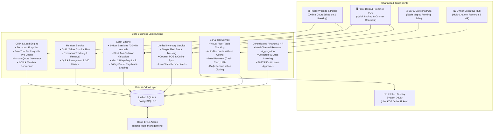

# 🏆 The Champions Club - Sports Club Management System
### *The Digital Backbone of a Modern Club That Has Outgrown WhatsApp and Excel*

[](https://www.python.org/)
[](https://fastapi.tiangolo.com/)
[](https://www.odoo.com/)
[-success?logo=pytest)](tests/)
[](app/static/css/styles.css)
[](LICENSE)
[]()

> **Official Solution for the Odoo Hackathon & Challenge:**  
> A complete, unified software platform that solves the real, day-to-day operational headaches of a modern tennis, cricket, and padel club. Designed and implemented with a **Dual-Delivery Architecture**: a **standalone, turnkey interactive web platform** for immediate live evaluation and testing, plus a **native Odoo 17/18 module suite** (`odoo_addons/sports_club_management/`). Built with a luxury **Warm Amber & Espresso Glassmorphism UI** featuring frosted acrylic panels, ambient glowing caramel backdrops, and crisp ivory pill controls.

---

## 📑 Table of Contents (Content Table)

- [📖 Executive Summary & The Problem](#-executive-summary--the-problem)
- [📊 Project Details & Architecture Content Table (Master Matrix)](#-project-details--architecture-content-table-master-matrix)
- [🏗️ System Architecture & Data Flow](#️-system-architecture--data-flow)
- [🎨 Warm Amber Glassmorphism Design System](#-warm-amber-glassmorphism-design-system)
- [🌟 Solution Walkthrough: The 6 Problem Scenes](#-solution-walkthrough-the-6-problem-scenes)
  - [1️⃣ Scene 1: A New Member Walks In](#1️⃣-scene-1-a-new-member-walks-in)
  - [2️⃣ Scene 2: Booking a Court on a Busy Evening](#2️⃣-scene-2-booking-a-court-on-a-busy-evening)
  - [3️⃣ Scene 3: Gearing Up Before a Match](#3️⃣-scene-3-gearing-up-before-a-match)
  - [4️⃣ Scene 4: After the Match, at the Bar](#4️⃣-scene-4-after-the-match-at-the-bar)
  - [5️⃣ Scene 5: A Stranger Finds the Club Online](#5️⃣-scene-5-a-stranger-finds-the-club-online)
  - [6️⃣ Scene 6: The Owner, at the End of the Month](#6️⃣-scene-6-the-owner-at-the-end-of-the-month)
- [🚀 Quick Start Guide (Standalone Web Platform)](#-quick-start-guide-standalone-web-platform)
- [🧪 Automated Test Suite (100% Pass)](#-automated-test-suite-100-pass)
- [📦 Native Odoo 17/18 Addon](#-native-odoo-1718-addon-odoo_addonssports_club_management)
- [📂 Project Directory Structure](#-project-structure)
- [🛡️ License & Contributors](#️-license)

---

## 📊 Project Details & Architecture Content Table (Master Matrix)

This comprehensive content table summarizes all domain modules, problem scenes from the challenge specification, implemented business logic, underlying data models, live routes, and automated verification status:

| Scene & Module | Problem Addressed | Implemented Logic & Constraints | Domain Models | Live Web Route | API Endpoint | Test Status |
|:---|:---|:---|:---|:---|:---|:---:|
| **Scene 1: Front Desk & Members** | Fragmented spreadsheets, lost renewals, slow member recognition | Gold (100% free court), Silver (50%), Junior (60%) tiers; instant search by ID/phone/name; automated 12-mo expiration; 1-click renewal | `Member`, `MembershipTier` | [`/members`](http://127.0.0.1:8000/members) | `/api/v1/members` | ✅ 100% Pass |
| **Scene 2: Court Scheduling** | WhatsApp chaos, double-booking disputes, monopolized evening slots | 1-hour sessions with 30-min staggered slots; strict anti-collision conflict rejection (HTTP 409); max 2 plays/member/day; Friday Social play mode | `Court`, `CourtBooking` | [`/courts`](http://127.0.0.1:8000/courts) | `/api/v1/courts` | ✅ 100% Pass |
| **Scene 3: Pro Gear Shop** | Counter POS sales desynchronized from sofa/online orders | Unified single-shelf inventory; instant real-time deduction; member auto-discounts (Gold 20%, Silver 10%); low-stock alerts (<5 units); Click & Collect / Delivery | `Product`, `ShopOrder`, `ShopOrderItem` | [`/shop`](http://127.0.0.1:8000/shop) | `/api/v1/shop` | ✅ 100% Pass |
| **Scene 4: Sports Bar & KOT** | Paper slips lost, unpaid tabs, kitchen order confusion | Visual floor table map; live digital Kitchen Order Tickets (KOT); member discounts without asking; multi-payment settlement (Cash/Card/UPI); end-of-day register closing | `BarTable`, `BarTab`, `BarOrderItem` | [`/bar`](http://127.0.0.1:8000/bar) & [`/kitchen`](http://127.0.0.1:8000/kitchen) | `/api/v1/bar` | ✅ 100% Pass |
| **Scene 5: Website & CRM** | Unanswered website leads, vanished trial requests | Public free trial booking with pro coach; 5-stage CRM Kanban pipeline; instant quotation generator with coaching add-ons; 1-click member conversion | `TrialBooking`, `CrmLead`, `Quotation` | [`/`](http://127.0.0.1:8000/) & [`/crm`](http://127.0.0.1:8000/crm) | `/api/v1/crm` | ✅ 100% Pass |
| **Scene 6: Owner Financials** | Blind to multi-channel earnings, scattered payment apps | Consolidated multi-source revenue aggregation; Cash/Card/UPI/Online split; corporate team invoicing; staff roster & payroll ledger; 1-click leave approvals | `CorporateInvoice`, `Employee`, `EmployeeLeave` | [`/owner`](http://127.0.0.1:8000/owner) | `/api/v1/finance` | ✅ 100% Pass |

---

## 🎨 Warm Amber Glassmorphism Design System

Inspired by modern luxury evening ambient smart lighting, the entire interface features a custom **Warm Amber & Espresso Glassmorphism** design system:

* **Ambient Espresso Backdrop**: Deep velvet dark-chocolate/espresso base (`#120b08`) with radiant warm amber, glowing caramel, and burnt orange radial halation.
* **Warm Frosted Panels**: Translucent smoky acrylic surfaces (`rgba(30, 19, 13, 0.68)`) with heavy blur (`backdrop-filter: blur(24px)`), soft apricot borders (`rgba(254, 215, 170, 0.15)`), and inner specular highlights.
* **Crisp Ivory & Amber Pills**: Selected controls and active tabs feature soft ivory pills (`#fdfaf5`, text `#1c1917`, font-bold 800) with glowing warm amber secondary buttons.
* **Luminous Table & Content Containers**: Data tables and content grids feature frosted headers (`rgba(28, 17, 11, 0.88)`), golden typography (`#fcd34d`), and warm hover transitions.

---

## 📖 Executive Summary & The Problem

The Champions Club is a thriving multi-sport facility with championship tennis courts, floodlit cricket nets, panoramic padel courts, a professional gear shop, and a bustling post-match bar & cafeteria.

### The Problem Today
* **Court Bookings**: Arranged chaotically over WhatsApp messages and phone calls.
* **Member Lists**: Maintained in fragile, disconnected Excel spreadsheets.
* **Bar Receipts**: Scribbled on loose paper slips; kitchen orders get lost, tabs go missing.
* **Court Availability**: Manually checked via phone calls; double-booking disputes.
* **Inventory Misalignment**: Shop stock sold at the counter doesn't match online orders.
* **Financial Blindspot**: Cash, Card, UPI, and online bank payments are scattered across different apps with zero unified visibility for the owner.

### The Solution: One Unified Platform
The Champions Club Management System replaces WhatsApp and Excel with an integrated digital backbone that unites front-desk operations, automated court collision prevention, real-time shared-shelf inventory, digital kitchen order tickets (KOT), website CRM lead generation, and consolidated executive financials.

---

## 🏗️ System Architecture & Data Flow



---

## 🌟 Solution Walkthrough: The 6 Problem Scenes

Every scene in the challenge PDF is mapped directly to a purpose-built feature in the application:

### 1️⃣ Scene 1: A New Member Walks In
* **Tiered Membership Structure**:
  * **Gold Tier (₹5,000/mo)**: Premium full access, **100% Free Court Access (₹0 court fees)**, 20% shop discount, 20% bar discount, free entry to Friday Social Play.
  * **Silver Tier (₹2,500/mo)**: Standard membership, **50% off court fees (₹400/hr)**, 10% shop discount, 10% bar discount.
  * **Junior Tier (₹1,500/mo)**: Dedicated youth athletes under 18, **60% off court fees (₹320/hr)**, 10% shop discount, 5% bar discount.
  * **Walk-in / Guest**: Standard rates (₹800/hr tennis, ₹1000/hr cricket), 0% discount.
* **Automatic Expiration & Renewal Tracking**: Expiry date calculated upon signup. Active, Expiring Soon, and Expired badges displayed dynamically. Staff can renew memberships with one click (`/members`).
* **Instant Front-Desk Recognition**: Staff can search by Member ID (`TC-GOLD-0001`), Phone, or Name in milliseconds. The member 360 view displays their photo, tier privileges, active bar tabs, recent court bookings, and lifetime club spend.

### 2️⃣ Scene 2: Booking a Court on a Busy Evening
* **Slot Configuration**: Sessions last **exactly 1 hour**; new slots open on **30-minute staggered intervals** (e.g. 18:00–19:00, 18:30–19:30).
* **Strict Anti-Collision Engine**: Mathematically guarantees that *two people never end up on the same court at the same time*. The overlap validation rejects conflicting reservations with HTTP 409 Conflict.
* **Daily Member Limit**: Validates that *each member can play at most twice a day*. Attempts to book a 3rd session on the same date are automatically rejected.
* **Dynamic Tier Pricing**: Rates calculate automatically based on the member's tier (Gold: ₹0, Silver: ₹400, Junior: ₹320, Walk-in: ₹800 + 18% GST).
* **Friday Night Social Play**: Special Friday 19:00–22:00 mode where multiple members register and share one court session (up to 8 players).

### 3️⃣ Scene 3: Gearing Up Before a Match
* **Unified Single-Shelf Inventory**: Solves the core challenge: *"What a member buys at the counter and what they order from their sofa come from the same shelf."*
* **Real-Time Stock Deduction**: When a walk-in buys a can of Wilson balls at the front desk counter 10 minutes before play, online stock decreases instantaneously.
* **Click & Collect & Delivery**: Members can order shoes or apparel from home and select club pickup (Click & Collect) or home delivery.
* **Low-Stock Alerts**: Products falling below reorder thresholds (e.g. 5 units) display automated alerts for staff to restock.
* **Tier Auto-Discounts**: Member tier discounts (20% for Gold, 10% for Silver) apply automatically at checkout.

### 4️⃣ Scene 4: After the Match, at the Bar
* **Visual Floor Table Map**: Live tracker for Main Hall, Terrace Patio, Lounge, and Bar Counter showing `Available` vs `Occupied` tables.
* **Digital Kitchen Order Tickets (KOT)**: Orders placed at the POS route immediately to the live Kitchen Display screen (`/kitchen`). Tickets include order timestamps, table numbers, item quantities, and chef notes (e.g., *"Less spice"*, *"No ice"*).
* **Running Tabs**: Members can open a tab, accumulate drinks and meals throughout their post-match social, and settle before leaving.
* **Automatic Discounts Without Asking**: Members automatically receive their discount (Gold 20%, Silver 10%, Junior 5%) without ever having to ask staff.
* **Multi-Payment Settlement**: Settle tabs via **Cash, Card, or UPI**.
* **End-of-Day Register Closing**: Generates a reconciliation report for the owner displaying total bar sales, payment breakdown by Cash/Card/UPI, tax collected, and tabs count.

### 5️⃣ Scene 5: A Stranger Finds the Club Online
* **Public Website & Live Schedule**: Responsive public portal (`/`) showcasing club amenities, membership plans comparison, live court availability grid, and gear shop preview.
* **Book a Free Trial Session**: Prospective players can reserve a 1-hour trial session with Head Coach David directly online.
* **CRM & Lead Capture Pipeline**: Enquiries never vanish. Every web contact is captured into the CRM pipeline with status progression: `New` ➔ `Contacted` ➔ `Trial Booked` ➔ `Quote Sent` ➔ `Converted`.
* **Automated Quotation Generator**: Staff can generate custom annual membership quotes with coaching add-ons and locked-in promotional pricing.
* **1-Click Member Conversion**: Converts accepted leads into active club members with one click, creating their member code and privileges profile.

### 6️⃣ Scene 6: The Owner, at the End of the Month
* **Consolidated Financial Dashboard (`/owner`)**: Answers the owner's question: *"How much did we earn, from where, and what do we owe?"*
* **Unified Revenue by Source**: Aggregates revenue across Courts, Pro Gear Shop, Bar & Cafeteria, Membership Dues, and Corporate Client Invoices.
* **Payment Method Distribution**: Aggregated split across **Cash, Card, UPI, and Online Bank Transfers**.
* **Flexible Time Horizons**: Real-time filtering for **Today, This Week, This Month, and All Time**.
* **Corporate & Tournament Invoicing**: Issue professional GST invoices to corporate sports teams and tournament organizers, with payment status tracking.
* **Staff Shifts & Leave Approvals**: Employee roster, scheduled shifts, monthly payroll tracking, and manager 1-click leave approvals (`Approve` / `Reject`).
* **Tax Reporting**: Consolidated GST liabilities breakdown across court services (18%), sports merchandise (12%), and F&B dining (5%).

---

## 🚀 Quick Start Guide (Standalone Web Platform)

The turnkey web application runs instantly with zero complex dependencies.

### 1. Clone the Repository
```bash
git clone https://github.com/manas0306-ops/Sports-Club-Management.git
cd Sports-Club-Management
```

### 2. Install Dependencies
```bash
python -m pip install -r requirements.txt
```

### 3. Seed Realistic Demo Data
Pre-populates The Champions Club with members in all tiers, courts, unified shop inventory, active bar tabs, KOT tickets, CRM leads, and corporate invoices:
```bash
python seed_data.py
```

### 4. Start the Application Server
```bash
python run.py
```
Open your browser and navigate to:
* **Public Club Website & Matrix**: [http://127.0.0.1:8000](http://127.0.0.1:8000)
* **Member Directory & Front Desk**: [http://127.0.0.1:8000/members](http://127.0.0.1:8000/members)
* **Court Master Schedule**: [http://127.0.0.1:8000/courts](http://127.0.0.1:8000/courts)
* **Pro Gear Shop (Unified Stock)**: [http://127.0.0.1:8000/shop](http://127.0.0.1:8000/shop)
* **Bar & Cafeteria POS**: [http://127.0.0.1:8000/bar](http://127.0.0.1:8000/bar)
* **Live Kitchen KOT Display**: [http://127.0.0.1:8000/kitchen](http://127.0.0.1:8000/kitchen)
* **CRM & Member Acquisition**: [http://127.0.0.1:8000/crm](http://127.0.0.1:8000/crm)
* **Owner Financials & HR Hub**: [http://127.0.0.1:8000/owner](http://127.0.0.1:8000/owner)
* **Interactive OpenAPI / Swagger Documentation**: [http://127.0.0.1:8000/api/v1/docs](http://127.0.0.1:8000/api/v1/docs)

---

## 🧪 Automated Test Suite (100% Pass)

The project includes a comprehensive test suite in `tests/` verifying all constraints from the challenge PDF:

```bash
python -m pytest -v
```

### Test Coverage Highlights:
| Test File | Verified Requirement | Status |
|---|---|---|
| `test_court_bookings.py` | Strict anti-collision prevents overlapping bookings (HTTP 409) | ✅ Passed |
| `test_court_bookings.py` | Enforces max 2 bookings per member per day | ✅ Passed |
| `test_court_bookings.py` | Gold tier 100% free court access (₹0 fee) | ✅ Passed |
| `test_court_bookings.py` | Silver tier 50% court discount + 18% GST calculation | ✅ Passed |
| `test_court_bookings.py` | Friday Social Play multi-player session sharing | ✅ Passed |
| `test_inventory.py` | Unified inventory: Counter POS & Sofa orders deduct from same shelf | ✅ Passed |
| `test_inventory.py` | Gold 20% shop discount applied automatically | ✅ Passed |
| `test_inventory.py` | Insufficient stock protection & low-stock alerts | ✅ Passed |
| `test_bar_tabs.py` | Automatic member discount applied without asking | ✅ Passed |
| `test_bar_tabs.py` | KOT ticket routing to kitchen display system | ✅ Passed |
| `test_bar_tabs.py` | Multi-payment (Cash, Card, UPI) table release | ✅ Passed |
| `test_members.py` | Member code generation (`TC-GOLD-0001`) & 12-month expiry | ✅ Passed |
| `test_members.py` | Fast member search & renewal action | ✅ Passed |
| `test_crm_and_finance.py` | Zero-lost enquiry capture & 1-click member conversion | ✅ Passed |
| `test_crm_and_finance.py` | Owner consolidated revenue & payment method breakdown | ✅ Passed |
| `test_crm_and_finance.py` | Employee leave approval / rejection workflow | ✅ Passed |

---

## 📦 Native Odoo 17/18 Addon (`odoo_addons/sports_club_management`)

For evaluators reviewing standard Odoo modules, the repository includes a complete Odoo custom module adhering to official Odoo 17/18 standards:

```
odoo_addons/sports_club_management/
├── __init__.py
├── __manifest__.py                 # Dependencies: base, mail, product, sale, point_of_sale, hr, account
├── models/
│   ├── sports_member.py           # sports.member model with Gold/Silver/Junior logic & expiry
│   ├── sports_court.py            # sports.court model for Tennis & Cricket
│   ├── sports_booking.py          # sports.court.booking with SQL & Python anti-collision rules
│   ├── sports_shop.py             # product.template & sale.order single-shelf stock extensions
│   ├── sports_bar.py              # sports.bar.tab, sports.bar.table, sports.bar.order.line
│   ├── sports_crm.py              # sports.trial.booking & crm.lead conversion
│   └── sports_finance_hr.py       # account.move corporate billing & hr.leave extensions
├── views/
│   ├── sports_menus.xml           # Root & child menus
│   ├── sports_member_views.xml    # Tree, Form, Kanban, Renewal button, 360 history notebook
│   ├── sports_court_views.xml     # Master Calendar, Gantt, Tree, Form
│   ├── sports_shop_views.xml      # Single-shelf inventory & low stock warnings
│   ├── sports_bar_views.xml       # Running tabs, table floor map, KOT lines
│   ├── sports_crm_views.xml       # Trial session booking pipeline
│   └── sports_finance_views.xml   # Corporate invoices & leave approvals
├── security/
│   ├── sports_security.xml        # RBAC Groups: Front Desk, Bar Staff, Club Manager
│   └── ir.model.access.csv        # Complete model permissions
└── data/
    ├── sports_data.xml            # Sequences for Member IDs, Bookings, Tabs, Trials
    └── demo_data.xml              # Preloaded courts, members, and tables
```

### Installing into an Existing Odoo Instance:
1. Copy or symlink `odoo_addons/sports_club_management` into your Odoo `addons_path`.
2. Activate Developer Mode in Odoo Settings.
3. Navigate to **Apps** ➔ **Update Apps List**.
4. Search for `Sports Club Management System` and click **Install**.

---

## 📂 Project Structure

```
Sports-Club-Management/
├── app/
│   ├── config.py                  # Tiers, discounts, tax rates, operational rules
│   ├── database.py                # SQLAlchemy engine & session maker
│   ├── main.py                    # FastAPI application entrypoint
│   ├── models/                    # Domain models for Member, Court, Shop, Bar, CRM, Finance
│   ├── schemas/                   # Pydantic schemas for request/response validation
│   ├── services/                  # Business logic services enforcing challenge constraints
│   ├── routes/                    # REST API routers & server-rendered view controllers
│   ├── static/                    # Custom Warm Amber CSS, JS utilities, toast notifications
│   └── templates/                 # Warm Frosted Jinja2 templates for all 6 scenes + portal
├── odoo_addons/                   # Official Odoo 17/18 Addon suite
│   └── sports_club_management/    # Models, XML views, security, demo data
├── tests/                         # Automated Pytest suite (16 tests, 100% pass)
├── seed_data.py                   # Pre-populates rich demonstration scenario
├── run.py                         # 1-click application runner
├── requirements.txt               # Python package dependencies
├── .gitignore                     # Clean repository ignore rules
└── README.md                      # Complete system documentation & content table
```

---

## 🛡️ License

This project is licensed under the **GNU Lesser General Public License v3.0 (LGPL-3.0)** in accordance with standard Odoo community guidelines.

---
**Built with passion for The Champions Club & the Odoo Developer Community.**
