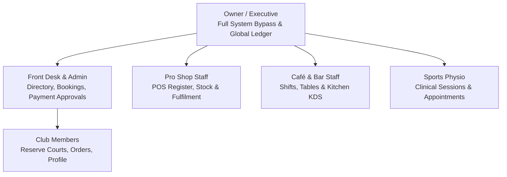
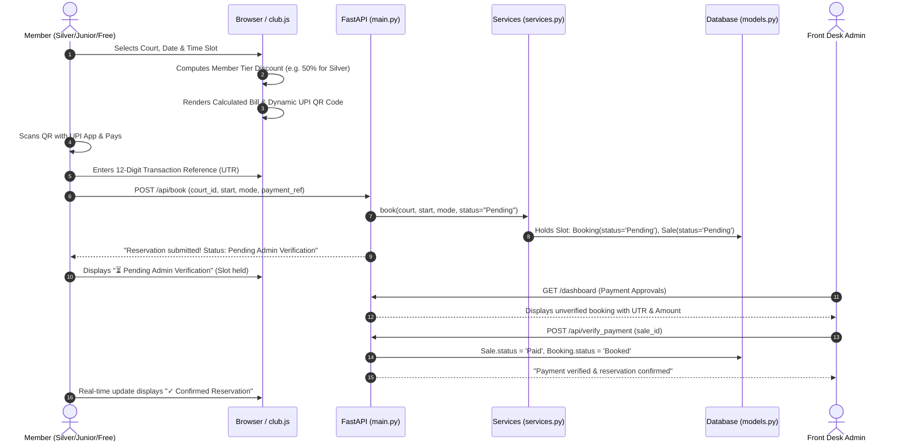
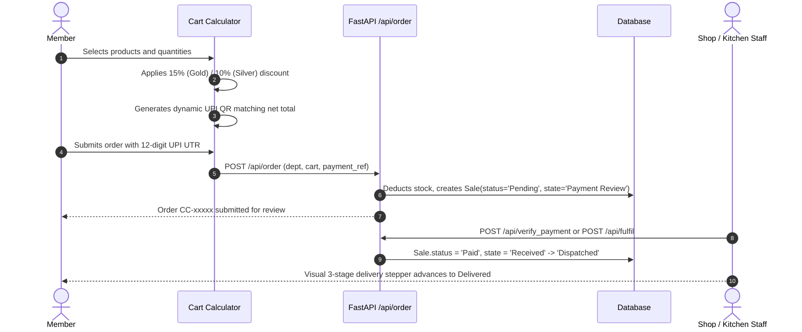
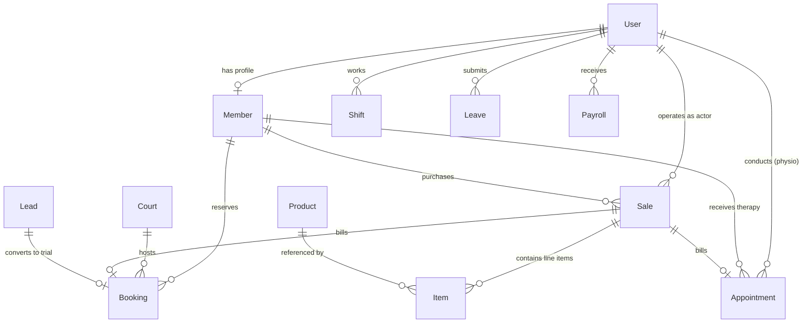

# System Architecture & Technical Design Document: The Champions Club

**Document Version:** 2.4.0  
**Status:** Approved & Implemented  
**Classification:** Technical Architecture & System Specification  
**Authors:** `manas0306-ops`, `27vedantkumar`, `ujjwalprakash07`, `Uj1710glitch`

---

## 1. Executive Summary & System Goals

**The Champions Club** is a high-performance, full-stack Sports Club & Hospitality Management Platform designed to streamline sports facility scheduling, member privileges, pro shop retail inventory, kitchen display operations, and financial auditing into a unified, secure system.

### Core Architectural Objectives
* **Zero-Build, Low-Overhead Stack:** Engineered with FastAPI and Jinja2 SSR with native ES2022/CSS3—delivering sub-20ms response times without heavy frontend node builds or bundle overhead.
* **Strict Role-Based Access Control (RBAC):** Military-grade role isolation separating executive analytics, operations administration, retail shop, kitchen/bar, sports recovery clinic, and multi-tier members.
* **High-Integrity Financial & Booking Workflow:** Mandatory calculated bill generation with dynamic UPI QR code rendering, requiring user transaction reference (UTR) capture before admin/owner approval.
* **Concurrency & Collision Prevention:** Deterministic slot locking and transaction serialisation (`BEGIN IMMEDIATE` on SQLite, advisory locks on PostgreSQL) preventing double-booking and stock overselling.

---

## 2. High-Level System Architecture

The system follows a modern multi-tiered client-server architecture with decoupled presentation, domain services, security layers, and resilient database backends.

```mermaid
flowchart TD
    subgraph Clients["Client Access Layer"]
        M[Club Members<br/>Gold / Silver / Free]
        A[Front Desk & Admin]
        S[Staff<br/>Shop / Bar / Physio]
        O[Club Executive / Owner]
    end

    subgraph Gateway["Network & Edge Ingress"]
        CF[Cloudflare Tunnel / Edge CDN]
        UV[Uvicorn ASGI High-Performance Server]
    end

    subgraph AppServer["FastAPI Application Core"]
        AUTH[Security & Token Auth Layer<br/>HMAC-SHA256 & Session Nonces]
        DISP[Action Dispatcher & CSRF Guard<br/>/api/{action}]
        SSR[Jinja2 SSR Template Engine<br/>Workspace & Tool Partials]
        ROLES[RBAC Policy Enforcer<br/>ROLES Matrix]
    end

    subgraph Domain["Business Services Layer"]
        CS[Court Scheduling & Slot Lock Engine]
        PR[Pricing & Tier Discount Calculator]
        IS[Inventory & Order State Stepper]
        KDS[Kitchen Order Ticket Workflow]
        APPR[Financial Verification & Approvals]
    end

    subgraph Data["Persistence Layer"]
        ORM[SQLAlchemy 2.0 ORM]
        DB[(SQLite / PostgreSQL Engine<br/>Integer Paise Storage)]
    end

    Clients -->|HTTPS / WSS| CF
    CF --> UV
    UV --> AUTH
    AUTH --> ROLES
    ROLES --> DISP
    ROLES --> SSR
    DISP --> Domain
    Domain --> ORM
    ORM --> DB
```

---

## 3. Role-Based Access Control (RBAC) & Security Architecture

### 3.1 Role Hierarchy & Scoped Boundaries



### 3.2 Permission & Capability Matrix

| Feature / Module | Owner (`owner`) | Admin (`desk`) | Shop (`shop`) | Café (`bar`) | Physio (`physio`) | Member (`member`) |
| :--- | :---: | :---: | :---: | :---: | :---: | :---: |
| **Executive P&L & Analytics** | ✅ Full | ❌ Blocked | ❌ Blocked | ❌ Blocked | ❌ Blocked | ❌ Blocked |
| **HR Payroll & Decisions** | ✅ Full | ❌ Blocked | ❌ Blocked | ❌ Blocked | ❌ Blocked | ❌ Blocked |
| **Corporate B2B Invoices** | ✅ Full | ❌ Blocked | ❌ Blocked | ❌ Blocked | ❌ Blocked | ❌ Blocked |
| **Global Transaction Ledger** | ✅ Full | ✅ Front Desk | ❌ Blocked | ❌ Blocked | ❌ Blocked | ❌ Blocked |
| **Member Account Directory** | ✅ Full | ✅ Full | ❌ Blocked | ❌ Blocked | ❌ Blocked | ❌ Blocked |
| **Payment Approvals Board** | ✅ Full | ✅ Verify/Reject | ❌ Blocked | ❌ Blocked | ❌ Blocked | ❌ Blocked |
| **Court Slot Maintenance Blocker** | ✅ Full | ✅ Block/Unblock| ❌ Blocked | ❌ Blocked | ❌ Blocked | ❌ Blocked |
| **Add / Remove Catalog Products** | ✅ Full | ✅ All | ✅ Shop Only | ✅ Café Only | ❌ Blocked | ❌ Blocked |
| **Inventory Restock & Fulfilment** | ✅ Full | ❌ Blocked | ✅ Shop Only | ❌ Blocked | ❌ Blocked | ❌ Blocked |
| **POS Register & Shifts** | ✅ Full | ❌ Blocked | ✅ Shop POS | ✅ Café Shift| ❌ Blocked | ❌ Blocked |
| **Kitchen Display System (KDS)** | ✅ Full | ❌ Blocked | ❌ Blocked | ✅ KOT Queue | ❌ Blocked | ❌ Blocked |
| **Physio Clinical Records** | ✅ Full | ❌ Blocked | ❌ Blocked | ❌ Blocked | ✅ Own Patients| ❌ Blocked |
| **Court Booking & Ordering** | ✅ Full | ✅ Walk-in POS| ❌ Counter | ❌ Counter | ❌ Blocked | ✅ Self Only |
| **Personal Profile & Password** | ✅ Full | ✅ Own | ✅ Own | ✅ Own | ✅ Own | ✅ Own |

### 3.3 Cryptographic Security & Session Life Cycle
1. **Cookie Signing:** State is signed using HMAC-SHA256 with a private rotating `.club-secret`. Cookies are marked `HttpOnly`, `SameSite=Strict`, and `Secure` when served over TLS.
2. **Session Nonces:** Each active login produces an independent, cryptographically random nonce stored as a SHA-256 digest in `users.sessions` with a rolling 12-hour expiry.
3. **Instant Session Revocation:** Logging out deletes the specific session hash from the user's database record, immediately invalidating compromised tokens.
4. **CSRF Prevention:** All state-modifying requests (`POST /api/{action}`) require an explicit `X-Club-Request: 1` header, rejecting cross-site forgery attempts.

---

## 4. End-to-End Business Workflows

### 4.1 Court Reservation & Payment Verification Flow



### 4.2 Pro Shop & Café POS / Order Flow



---

## 5. Data Architecture & Database Schema (LLD)

### 5.1 Entity Relationship Diagram (ERD)



### 5.2 Core Schema Specifications

#### `users` Table
| Column | Type | Constraints | Description |
| :--- | :--- | :--- | :--- |
| `id` | Integer | Primary Key | Unique user account ID |
| `email` | String | Unique, Indexed, Not Null | Normalized login email address |
| `name` | String | Not Null | Full legal display name |
| `password`| String | Not Null | Bcrypt salted cryptographic password hash |
| `role` | String | Default: 'member' | System role (`owner`, `desk`, `shop`, `bar`, `physio`, `member`) |
| `active` | Boolean| Default: True | Account active status (soft-delete flag) |
| `sessions`| JSON | Default: `[]` | Array of `{h: digest(nonce), exp: ISO8601}` active sessions |
| `shifts` | JSON | Default: `[]` | Array of scheduled duty roster shift windows |

#### `court_bookings` Table
| Column | Type | Constraints | Description |
| :--- | :--- | :--- | :--- |
| `id` | Integer | Primary Key | Booking sequence identifier |
| `court_id` | Integer | FK(`courts.id`), Index | Assigned sport court |
| `member_id`| Integer | FK(`members.id`), Index | Reserving member |
| `start` | DateTime| Indexed, Not Null | Slot commencement timestamp (IST) |
| `end` | DateTime| Not Null | Slot conclusion timestamp (start + 1 hour) |
| `is_social`| Boolean | Default: False | Friday Social session flag (capacity 8) |
| `status` | String | Default: 'Booked' | State: `Pending`, `Booked`, `Maintenance`, `Cancelled` |
| `sale_id` | Integer | FK(`sales.id`), Nullable | Linked financial transaction receipt |

#### `sales` Table
| Column | Type | Constraints | Description |
| :--- | :--- | :--- | :--- |
| `id` | Integer | Primary Key | Official Tax Receipt ID (`CC-XXXXX`) |
| `member_id`| Integer | FK(`members.id`), Nullable | Purchasing member (or null for Guest) |
| `actor_id` | Integer | FK(`users.id`) | Staff or member initiator |
| `department`| String | Not Null | `Courts`, `Shop`, `Bar`, `Physio`, `Memberships`, `B2B` |
| `mode` | String | Not Null | Payment Tender: `UPI`, `Card`, `Cash`, `Included` |
| `status` | String | Default: 'Paid' | Financial State: `Paid`, `Pending`, `Cancelled`, `Open` |
| `total` | Integer | Not Null | Gross payable amount in **Integer Paise** (₹100 = 10000) |
| `discount` | Integer | Default: 0 | Total member subsidy discount in Paise |
| `tax` | Integer | Default: 0 | Statutory GST component in Paise |
| `cost` | Integer | Default: 0 | Product base wholesale cost in Paise |
| `details` | JSON | Default: `{}` | Metadata: `payment_verified`, `payment_ref`, `state`, `address` |
| `created` | DateTime| Indexed | Order placement timestamp |
| `settled` | DateTime| Indexed, Nullable | Transaction verification & audit timestamp |

---

## 6. Frontend Presentation & Interaction Architecture

### 6.1 Server-Side Rendering (SSR) & Partial Composition
The user interface is structured hierarchically using Jinja2 templates:
```
templates/
├── base.html              # Core HTML5 shell, CSS styles, typography, SVG icons
├── workspace.html         # Sidebar dock, role navigation, user header layout
├── macros.html            # Reusable UI macros (f.form, f.cart, f.board, f.ledger)
├── admin.html             # Owner Executive Dashboard (P&L, Approvals, HR, Ledger)
├── desk.html              # Front Desk Operations (Schedule, Approvals, CRM)
├── desk_tools.html        # Front Desk Partial (Directory, Court maintenance blocker)
├── member.html            # Member Clubhouse Portal (Privileges, Cart, Tracking, Profile)
├── shop.html              # Pro Shop Terminal
├── shop_tools.html        # Pro Shop Partial (Stock inventory, catalog editor)
├── bar.html               # Café & Kitchen POS
├── bar_tools.html         # Café Partial (Table tabs, shifts, Kitchen KDS)
├── physio.html            # Sports Medicine Clinic
├── physio_tools.html      # Clinic Partial (Treatment schedule & notes)
└── bill.html              # Standalone Pro-Forma Invoice & UPI QR Sheet
```

### 6.2 Client-Side Reactivity (`static/club.js`)
* **Zero Framework Overhead:** All dynamic behaviors use native browser APIs (Fetch, DOM manipulation, Intl formatter).
* **Live Dynamic Bill Engine:** Intercepts court time selection and shopping cart changes to recalculate taxes, member subsidies, and generates instant UPI payment QR images using `api.qrserver.com`.
* **Asynchronous Form Pipeline:** Form actions execute via `fetch('/api/' + action)` with `X-Club-Request: 1`, providing instant animated feedback without page reloads.

---

## 7. Operational Deployment & Environment Specifications

### 7.1 Production Environment Requirements
* **Runtime:** Python 3.10+ (Tested on Python 3.11.9)
* **Web Server:** Uvicorn (ASGI) running behind Cloudflare Tunnel edge proxy.
* **Database Compatibility:**
  * **Development / Hackathon:** Embedded SQLite with foreign key pragmas and `BEGIN IMMEDIATE` transaction locking.
  * **Production Scale:** PostgreSQL 15+ using `pg_advisory_xact_lock` for cross-worker serialized writes.

### 7.2 Service Initialization & Management Commands

```powershell
# 1. Install Dependencies
python -m pip install -r requirements.txt

# 2. Database Seeding & Setup
python seed.py

# 3. Start Local ASGI Web Server
python -m uvicorn main:app --host 0.0.0.0 --port 8000 --reload

# 4. Launch Edge Cloudflare Tunnel
.\cloudflared.exe tunnel --url http://127.0.0.1:8000

# 5. Run Automated Security & Regression Suite
python verify.py
python tests/test_security_and_approvals.py
```

---

## 8. Reliability, Verification & Compliance

* **100% Deterministic Testing:** The regression test suites (`verify.py` and `tests/test_security_and_approvals.py`) execute in an isolated temporary database sandbox.
* **Audit Trail Compliance:** Every financial transaction records exact creation timestamps, settlement timestamps, verifying actor name, payment method, and external bank UTR reference numbers.
* **Reversal Accounting:** Cancellations and rejections never delete historical records; they append an offsetting reversal record (`Item.total = -s.total`) to preserve complete accounting audit trails.
